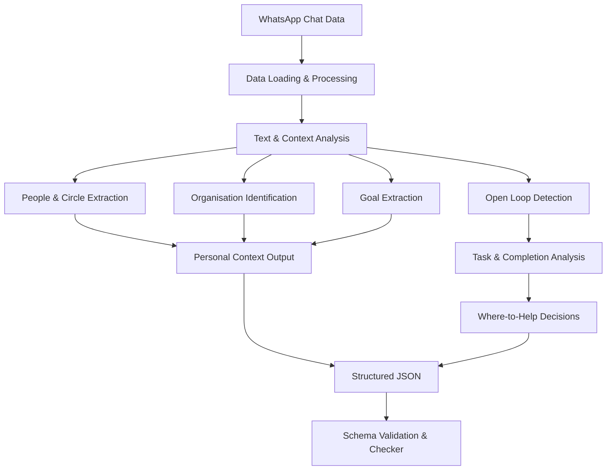

# XPERT
### WhatsApp Personal Context Intelligence Engine

<p align="center">
  **Turning everyday conversations into structured personal context.**
</p>

<p align="center">
  
  
  
  
</p>

---

## 01 | The Vision

People communicate, make plans, share responsibilities and discuss their goals through everyday conversations. However, important information often gets buried in hundreds of messages.

**Xpert aims to solve this context problem.**

This project builds a WhatsApp Personal Context Intelligence Engine that transforms unstructured conversations into structured information about an individual's social environment, goals, commitments and pending tasks.

The objective is not simply to extract messages, but to understand what matters, what remains unresolved and where an intelligent assistant could genuinely help.

## 02 | What the System Understands

The pipeline focuses on six interconnected dimensions of personal context.

- **People & Relationships:** Identify individuals and understand their conversational context.
- **Social Circles:** Group people based on their interactions and relationships.
- **Organisations:** Identify organisations and connect them with relevant conversations.
- **Goals:** Discover personal intentions, plans and longer-term objectives.
- **Open Loops:** Detect unanswered questions, pending requests, promises and commitments.
- **Where to Help:** Determine when an assistant should assist, remind or stay out.

## 03 | System Architecture

The project follows a modular Python architecture, separating context analysis, language processing and task extraction.



### Core Engineering Modules

| Module | Engineering Responsibility |
|---|---|
| `solution.py` | Orchestrates the complete execution pipeline |
| `nlp_engine.py` | Language and text processing |
| `ml_engine.py` | Machine-learning-related processing |
| `context_engine.py` | People, circles and organisation context |
| `task_engine.py` | Open loops and task status detection |
| `llm.py` | Optional LLM integration |
| `schema.json` | Structured output specification |
| `check.py` | Validation and challenge evaluation |

## 04 | Technical Methodology

**Stage 1 — Conversation Processing**

Load and process the supplied chat and message data, preserving relevant conversational information.

**Stage 2 — Context Understanding**

Analyse message content and available metadata to identify people, organisations and conversational relationships.

**Stage 3 — Goal & Task Extraction**

Apply extraction logic to identify explicit goals, requests, questions, promises and pending commitments.

**Stage 4 — Task Resolution**

Analyse completion indicators and distinguish between pending and completed conversational loops.

**Stage 5 — Assistant Intervention**

Determine where an assistant may provide useful support, such as helping with a task or reminding someone, while recognising situations where intervention is unnecessary.

**Stage 6 — Structured Output**

Generate JSON according to the supplied challenge schema and validate it using the provided checker.

## 05 | Technology & Tools

**Programming:** Python 3.11

**Data & Analysis:** Pandas, NumPy

**AI & ML:** NLP, Machine Learning, rule-based extraction, optional LLM integration

**Development:** PyCharm, Google Colab, Jupyter Notebook

**Version Control:** Git, GitHub

**Output:** JSON / JSONL

## 06 | Evaluation & Results

The solution was evaluated using the official development-set checker.

<blockquote>
  **19.1 / 56**
  
  Recorded development-set data score
</blockquote>

| Evaluation | Achieved |
|---|---:|
| Circles | 2.9 / 12 |
| Organisations | 2.1 / 8 |
| Chats | 6.1 / 8 |
| Open loops found | 3.9 / 14 |
| Open loops closed correctly | 4.0 / 14 |

**Validation:** The generated output passed structural validation.

*Goals and Where-to-help were not labelled in this development evaluation set. The score above is not the final hidden-test score.*

## 07 | Current Limitations & Engineering Roadmap

Building reliable personal context requires more than keyword matching. A major challenge is understanding intent, relationships and meaning across multiple messages.

The next engineering priorities are:

- Improve social-circle inference using richer relationship and interaction signals.
- Strengthen organisation recognition and chat association.
- Improve explicit and implicit goal extraction.
- Reduce false-positive open-loop detection.
- Improve matching between pending requests and their completion messages.
- Develop more context-aware assistant intervention decisions, including when the correct action is to stay out.
- Evaluate optional LLM integration against accuracy, latency and cost.

## 08 | Project Structure

```text
Xpert_lab/
│
├── solution.py
├── nlp_engine.py
├── ml_engine.py
├── context_engine.py
├── task_engine.py
├── llm.py
├── schema.json
├── check.py
├── run.sh
├── Xpert_lab.ipynb
├── README.md
├── WRITEUP.md
│
└── ai-logs/
    ├── README.md
    ├── project-development.md
    ├── debugging.md
    └── evaluation-and-improvements.md
```

## 09 | Run the Project

Clone the repository:

```bash
git clone https://github.com/Anuska111/Xpert_lab.git
cd Xpert_lab
```

Execute the solution:

```bash
./run.sh data/dev output.json
```

Validate the output:

```bash
python3 check.py data/dev output.json
```

*The challenge data and required runtime dependencies must be available locally.*

## 10 | AI-Assisted Development

AI tools were used as development collaborators for:

- Understanding challenge requirements.
- Exploring project architecture and extraction strategies.
- Implementation guidance and debugging.
- Analysing checker results.
- Identifying limitations and improvement opportunities.

The `ai-logs/` directory contains development notes and AI usage summaries. These are labelled as summaries rather than verbatim transcripts where applicable.

## 11 | Data Privacy

The project is designed to process the provided conversation dataset locally. Private WhatsApp conversation data and personal information should not be committed to the public repository.

---

## About

**Anuska Biswas**  
Mechanical Engineering | IIT (BHU), Varanasi

**GitHub:** [Anuska111](https://github.com/Anuska111)

*Xpert Winter Internship Build Challenge | November 2026*
